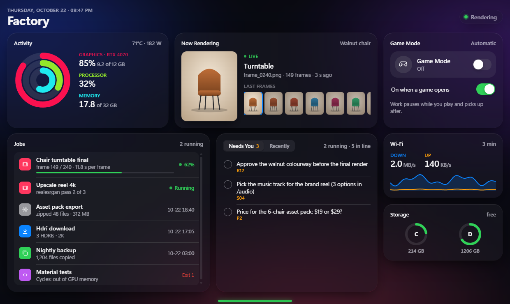
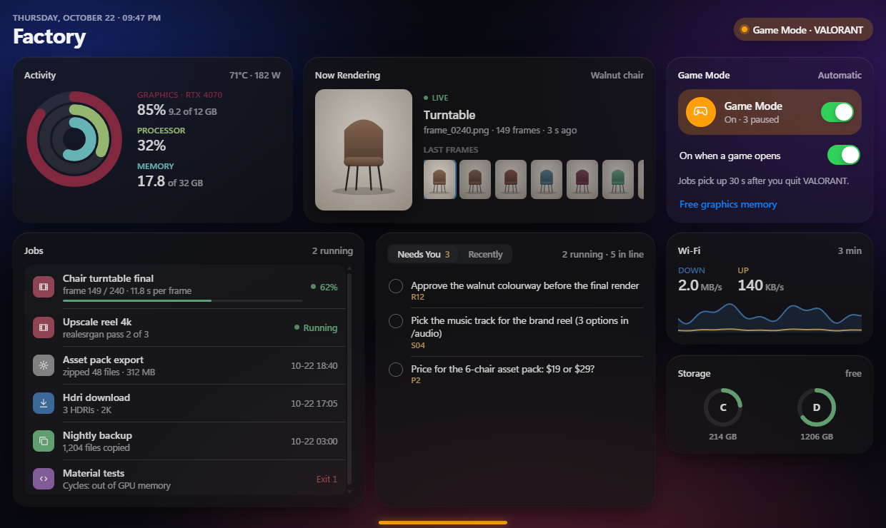

# Factory Console

**A live control panel for Windows PCs that render, train models and run AI agents, with a Game Mode that freezes all that work while you play, then resumes it exactly where it stopped.**

It lives at the top of your screen as a thin bar. Push the mouse against the top edge on the bar and the console slides down. Move away and it tucks back up.



- **Machine at a glance:**
  - Activity rings for GPU (NVIDIA), CPU and RAM, with VRAM, temperature and power;
  - network down and up;
  - every disk.
- **Now Rendering:** the newest frame your renders wrote, live, with the last frames underneath. Click one to look at it.
- **Jobs:** everything that runs on your machine, in one list:
  - your scheduled tasks;
  - your scripts, Blender renders, training runs and backups, which report in through a one-file helper or a single HTTP call.
- **Needs You / Recently** (optional): decisions waiting on you, and recent events, from a small SQLite ledger.
- **Game Mode:** when a game starts, your work processes are suspended in place, using no CPU, no GPU work and no network. When the game has been closed for 30 seconds, they resume from the exact point where they stopped. Nothing restarts and nothing is lost.



Everything runs on your PC. It needs no internet and has no telemetry, and the page loads nothing from outside.

## Install

You need Windows 10 or 11, Python 3.10–3.13 from [python.org](https://www.python.org) with the py launcher, and the WebView2 runtime (Windows 11 already has it).

```powershell
git clone https://github.com/zayed971/factory-console
cd factory-console
powershell -ExecutionPolicy Bypass -File install.ps1
```

The installer:
- creates a private `.venv` with [pywebview](https://pywebview.flowrl.com/);
- writes `config.json`;
- adds a Startup shortcut;
- starts the panel.

You don't need admin rights. To remove it, run `uninstall.ps1`.

**Server only** (no desktop panel, standard library only): `python server.py`, then open http://127.0.0.1:8787.

**Just look:** open http://127.0.0.1:8787/?demo=1 to see it with made-up data.

## Use

| | |
|---|---|
| Push the mouse to the top edge, on the bar | open (after a short pause, so reaching for a browser tab doesn't trigger it) |
| Move the mouse away | tuck it back up |
| `Ctrl+Alt+F` | open or close from anywhere |
| `P` | pin it open |
| `Esc` / `Shift+Esc` | tuck / quit |

The bar's colour shows the state:
- **green:** work running;
- **orange:** Game Mode holding;
- **grey:** idle;
- **red:** the console isn't answering.

It disappears while a full-screen app has focus or Game Mode is on, so it never sits over a game.

## Connect your own work

Anything that can make an HTTP request, or write a file, can show up in **Jobs**, with a progress bar and its last log line. Give it a `frames_dir` and its newest image also appears in **Now Rendering**.

**Python:** copy [`factory_feed.py`](factory_feed.py) into your project (standard library only):

```python
from factory_feed import Feed

job = Feed("walnut chair turntable", frames_dir=r"D:\renders\walnut")
for i in range(240):
    render_frame(i)
    job.update(progress=(i + 1) / 240, log=f"frame {i + 1} / 240")
job.done("240 frames")

with Feed("nightly backup"):        # done on success, failed with the error on an exception
    run_backup()
```

**Shell / scheduled tasks:**

```powershell
python factory_feed.py "nightly backup" running --progress 0.3 --log "copying D:"
python factory_feed.py "nightly backup" done --log "1,204 files"
```

**HTTP**, from Node, curl, a game engine, anything:

```bash
curl -X POST http://127.0.0.1:8787/api/feed -H "Content-Type: application/json" \
     -d '{"name": "train lora", "state": "running", "progress": 0.42, "log": "step 4200 / 10000"}'
```

`state` is one of `running`, `queued`, `done` or `failed`.
- A running job that goes quiet for 10 minutes is marked as stalled.
- Finished jobs fade out after a day.
- If the console isn't running, `factory_feed.py` writes the update into the `feeds/` folder, and the console picks it up when it starts.

**Blender:** [`examples/blender_render_feed.py`](examples/blender_render_feed.py) reports every frame of a render: progress, seconds per frame, time left and the output folder. It works headless (`blender -b scene.blend --python blender_render_feed.py -a`) or as a registered text block in the UI.

**PowerShell:** [`examples/report_from_powershell.ps1`](examples/report_from_powershell.ps1).

**Task Scheduler:** set `task_folder` (for example `\renders\`), and every task in that folder is listed with its state, last run and the last line of its log.

**Your own ledger:** point `ledger` at a SQLite file with `tasks(id, title, status, updated)` and `events(ts, actor, task, msg)`, and **Needs You** and **Recently** fill from it.

## Game Mode, in detail

- **Turning on:** a process from `games` starts, or you flip the switch.
- **What gets frozen:** processes whose name is in `pausable_names`, and, if `factory_paths` is set, only those whose command line contains one of those folders. Anything matching `never_pause` is left alone. The defaults freeze only `blender.exe` and `ffmpeg.exe`.
- **How:** frozen with `NtSuspendProcess`, the same mechanism Task Manager's debugger uses. They keep their memory and their place, and `NtResumeProcess` continues them.
- **Graphics memory:** a frozen render still holds its VRAM. **Free graphics memory** stops those renders, and their scheduled tasks start again after the game.
- **Ollama:** `stop_ollama_in_game` also stops Ollama during a game, so a model can't load onto the GPU mid-match. It starts again before your jobs resume.
- **Your own scripts:** set `game_mode_flag` to a JSON file, and they can check it before starting heavy work.

## Config (`config.json`)

The first run writes the defaults. All keys are optional.

| key | default | what |
|---|---|---|
| `title` | `Factory` | the name in the header |
| `host`, `port` | `127.0.0.1`, `8787` | where the server listens (local only by default) |
| `disks` | `auto` | every fixed drive, or a list like `["C","D"]` |
| `games` | common games | process names that switch Game Mode on |
| `resume_after_s` | `30` | how long a game must be closed before work resumes |
| `pausable_names` / `factory_paths` / `never_pause` | blender, ffmpeg / any / the console | what Game Mode freezes |
| `extra_frame_globs` | none | extra folders to watch for rendered frames |
| `task_folder` | none | Task Scheduler folder to list under Jobs |
| `feeds_dir` | `./feeds` | where feed updates are stored |
| `ledger`, `ledger_needs_status` | none, `needs-you` | the optional SQLite ledger |
| `game_mode_flag` | none | a JSON file your scripts can read |
| `stop_ollama_in_game`, `ollama_app` | `false`, default install | stop and restart Ollama around games |
| `shell.width`, `shell.height` | `1240`, `740` | panel size (CSS pixels; scaled for your display) |
| `shell.hotkey` | `ctrl+alt+f` | open/close shortcut |
| `shell.dwell_ms`, `shell.hide_after_ms`, `shell.pill_width` | `220`, `450`, `180` | how the edge feels |
| `shell.server_task` | none | start the server as that scheduled task instead of inside the panel |

## How it works

```
server.py   standard library only. A background sampler (2 s while someone watches, 10 s otherwise) reads:
            nvidia-smi, GetSystemTimes / GlobalMemoryStatusEx, netstat -e, disk space, the process list, Task Scheduler (COM).
            Page requests only read that cache, so they never wait on a slow query.
            /api/stream (Server-Sent Events), /api/jobs, /api/ledger, /api/frames, /frame, /api/info,
            POST /api/feed, POST /api/game/on|off|auto|free-gpu (same-origin only)
shell.py    pywebview (WebView2). A frameless, topmost tool window, clipped to the pill while tucked.
            A 30 ms watcher handles the hot edge, the leave timer, and the full-screen and Game Mode guard.
            RegisterHotKey for the shortcut. Starts the server if none is running, and checks on it every 30 s.
static/     one HTML file, no build step, no dependencies. ?panel for the drop-down layout, ?demo for made-up data.
```

Only one server can bind the port; a second copy refuses to start, so you never get two Game Mode watchers.

## Tests

From the repository folder on Windows, with Python 3.11 or newer:

```console
python -m unittest discover -s tests -v
```

The suite uses only the standard library and finishes in under 30 seconds. No
installation, GPU, admin rights, pywebview, or internet connection is needed.
HTTP tests use temporary loopback ports. Process commands and background watchers
are mocked, and temporary config, state, feeds, and images are isolated under
`tests/` and cleaned up after each test. The running console is never contacted.
GitHub Actions runs the suite on Windows with Python 3.11 and 3.13.

## Ideas welcome

Other GPU vendors (AMD/Intel), Linux and macOS ports, more feed examples (ComfyUI, kohya, Houdini, Unreal), and themes. Open an issue or a pull request.

## License

[MIT](LICENSE)
